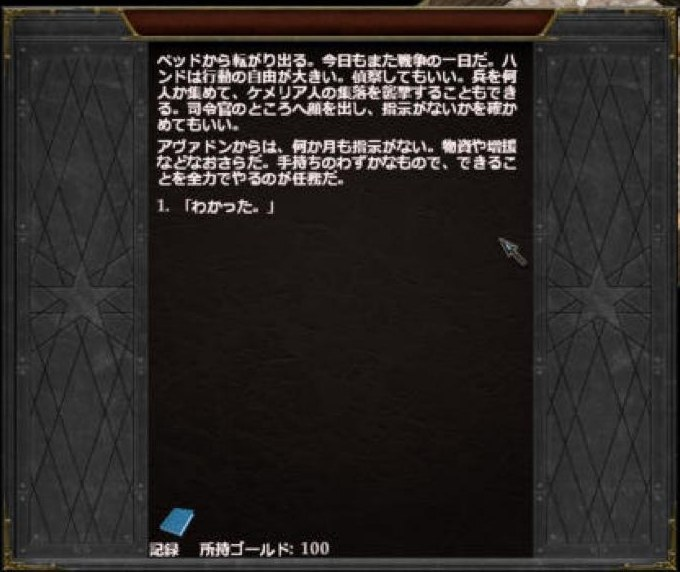

# Avadon 3: The Warborn 日本語化パッチ

Spiderweb Software の RPG「Avadon 3: The Warborn」（Steam 版）を日本語で遊べるようにする非公式パッチです。会話・本・アイテム・画面の文字・地名まで、ゲーム内のほぼすべての文章を日本語にします。

- **紹介ページ**: https://higesho.github.io/avadon3-tw-jp/
- **ダウンロード**: [Releases](https://github.com/higesho/avadon3-tw-jp/releases/latest) の `Avadon3_JP_<版>.zip`

## 使い方
1. ZIP の中身（`dsound.dll`、`avadon3_jp.ini`、`avadon3_jp` フォルダ）をゲームのフォルダ（`Avadon 3.exe` のある場所）にコピーする
2. Steam からゲームを起動する

ゲームの元のファイルは書き換えません。元に戻すときは、コピーしたファイルとフォルダを削除します。詳しくは ZIP 内の `avadon3_jp/README.txt` か紹介ページを見てください。

Steam 版（Windows）用です。GOG 版など他のストアの版は未確認です（対応できない版では日本語化を自動で止め、英語のまま起動します）。

## 翻訳の規模
| 対象 | 件数 |
|---|---|
| 会話・本・イベントの文 | 17,083 |
| 人物・アイテム・能力などの名前 | 1,679 |
| 画面・戦闘メッセージ | 928 |
| 地名・地図のラベル | 197 |
| 文字入りの画像 | 8 枚 |

## 不具合・誤訳の報告
表示の崩れ、誤訳、不自然な言い回しなどは [Issues](https://github.com/higesho/avadon3-tw-jp/issues) にお寄せください。

## 免責
本パッチは非公式のファン翻訳であり、Spiderweb Software とは関係ありません。使用は自己責任でお願いします。Avadon は Spiderweb Software の商標です。
